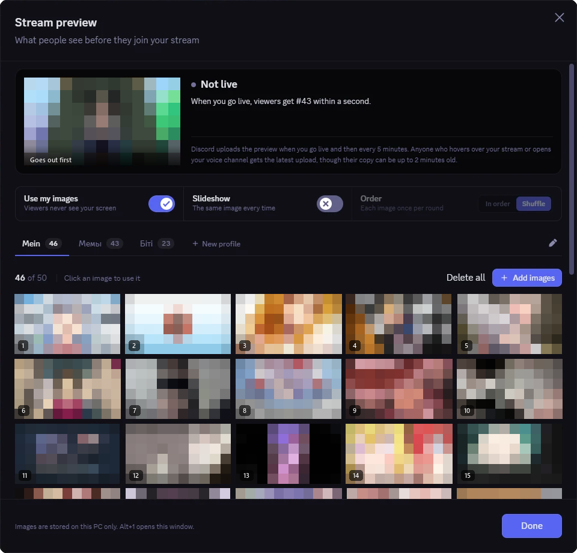
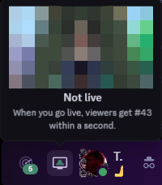

# CustomStream-Vencord

Custom stream preview for Vencord. The plugin sends your own image as the Discord stream preview instead of a frame of your screen. Profiles, slideshow, and a live view of what viewers see right now.

## How the preview works

Discord uploads a preview when you go live and then every 5 minutes. Anyone who hovers over your stream or opens your voice channel gets the latest upload, though their copy can be up to 2 minutes old. The plugin swaps the image in that upload, so your screen never leaves your PC.

The gallery shows which image viewers see, when it was sent and when the next one goes out.



The button next to your avatar shows the same status on hover and opens the gallery on click.



## Features

- Up to 6 profiles with 80 images each, drag the tabs to reorder them
- Slideshow in order or random, random never repeats an image until all were shown
- Click an image to send it next
- Drag images to reorder, or shuffle the whole profile at once
- Drop files or paste with Ctrl+V to add them
- Download a profile as a ZIP and add images from a ZIP
- Ctrl or Shift click to select several images
- `Alt+1` opens the gallery, the hotkey can be changed in the plugin settings
- Previews keep updating while the streamed window is minimized
- Images are stored locally in IndexedDB
- English and Russian, follows the Discord language or the one picked in the plugin settings

## Installation

Requires a [Vencord dev install](https://docs.vencord.dev/installing/).

The plugin lives in `src/userplugins/` inside that checkout, for example `C:\Vencord\src\userplugins\customStream`. Create the `userplugins` folder if it does not exist yet.

From the root of the checkout:

```bash
git clone https://github.com/MrTopQ/customStream-Vencord src/userplugins/customStream
pnpm build && pnpm inject
```

`pnpm inject` is only needed once, when this Vencord is not patched into Discord yet. Restart Discord, then enable **CustomStream-Preview** in Vencord settings, Plugins. It was called CustomStreamTopQ before, your settings and images move over by themselves.

## Notes

- If the panel button disappeared after a Discord update, the patch broke. Update the plugin from this repository.
- Without your own images, Discord needs a frame of the window. A minimized window gives no frames, so the preview stops updating until you restore it.
